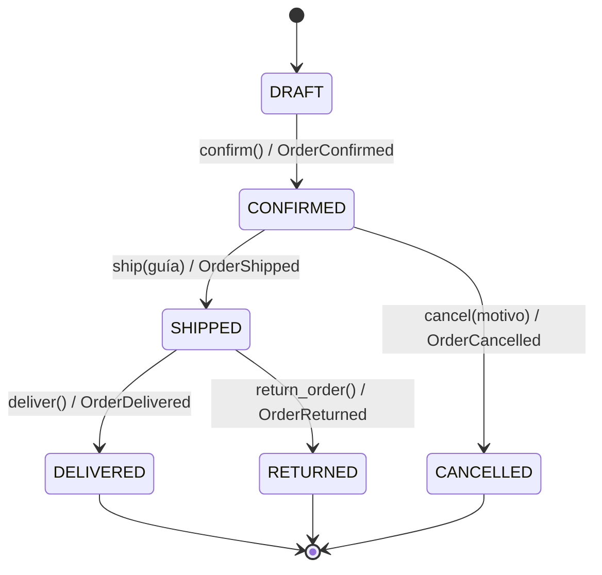

# Reporte — Actividad 4 TechStore

## Diagrama de estados

## Domain Events
Cada método de `Order` valida primero, cambia `status` después y registra el evento al final.
Por eso un intento inválido (p. ej. confirmar dos veces) lanza excepción y **no** deja evento.
Eventos: `OrderConfirmed`, `OrderShipped` (detalle: guía), `OrderCancelled` (detalle: motivo),
`OrderDelivered`, `OrderReturned`. Son inmutables y llevan `order_id` y `occurred_at` (UTC).

## Preguntas del reporte
1. **¿Por qué Decimal y no float?** El float representa mal fracciones decimales (0.1 + 0.2 ≠ 0.3);
   en dinero acumula errores de centavos. Decimal es exacto para precios en base 10
   (ver `test_total_vale_decimal_exacto`).
2. **Renglones vs. unidades.** El límite de 20 se aplica a la suma de cantidades: dos renglones de
   10 unidades son 20 unidades; contar filas permitiría pedidos enormes con pocos renglones.
3. **Ventaja de Specification.** Cada regla es un objeto pequeño, probable por separado y
   combinable con `&`, `|`, `~` sin tocar `Order` ni la API; cambiar una regla no rompe las demás.
4. **¿Por qué eventos solo tras transición válida?** Un evento afirma que algo ya ocurrió. Si se
   registrara antes de validar, quedarían eventos de hechos que nunca sucedieron.
5. **¿Qué se reutiliza si cambia FastAPI?** Todo `app/domain.py` y `app/specifications.py`: no
   importan FastAPI. Solo se reescribe la capa de interfaz (`app/api.py`).

## Reflexión personal (completar con tus propias palabras)
Tres errores que encontraste, cómo los solucionaste y qué aprendiste: _pendiente_.
